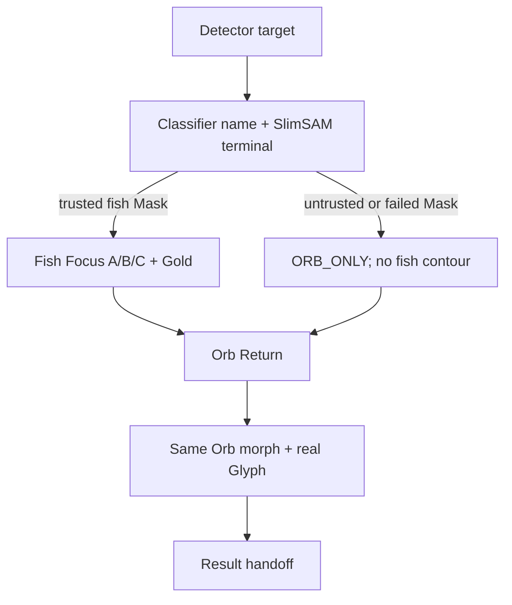

# 视觉组件 → Android Runtime 只读映射

基线 Main `74cad95b4f673bd9c8c60d16839f036d5886d933`；PR #317 Draft HEAD `81a0c257417c0be050e8dd57ace95e97619babf4`，仅作为 01 的待验工程实现。本文件不要求重构。路径均相对仓库根目录。`设计要求`与`现有代码`不是等同的验收状态。

| 组件 / 对照 / 帧 | 输入 → 输出 | 当前实现入口或缺口 | 依赖、复用与失败处理 |
| --- | --- | --- | --- |
| AIOrbCore / G01,G02,G05 / 01–03,10–12 | Orb state → 唯一水核 | `app/src/main/java/com/yujian/ai/ui/designsystem/components/aiorb/AIOrbCore.kt`; `ProcessingWaterOrb.kt`; Runtime WebP 见冻结 V1.1 合同 | 独立复用 Core；不替换、不整体淡出；资源失效则显示失败态，不画新球。PR #317 的 01 100% alpha 与 RenderEffect 清理待真机验收。 |
| OrbLayerRenderer / G01,G02,G05 / 01–03,10–12 | Core+内水+Mask → Orb 合成 | `ui/waterlight/core/WaterLightHost.kt`, `ui/waterlight/renderer/OrbRuntimeProfileV1.kt` | L01–L07 顺序；同一 SceneFrame 和 Core；缺层需诊断，不用单图冒充全栈。 |
| OrbGrassRenderer / G02,G05 / 02,03,11–12 | R01B Mask/Path + elapsed → 局部 UV 位移 | `ui/waterlight/renderer/OrbGrassMotionProfileV11.kt`, `OrbGrassWarpProgramV11.kt`; `app/src/main/assets/orb_r01b_v1_1/` | 可独立复用；根部固定，叶尖局部动；失效保留原 Core 烘焙水草，不绘制另一套叶片。 |
| OrbCaustics / G02,G05 / 02,03,11–12 | optical time + internal clip → 焦散 | `ui/waterlight/renderer/OrbCausticsAdapter.kt` | 与照片外围光分离；资源失败降为 Core 自身材质。 |
| OrbDroplets / G02,G05 / 01–03,11–12 | 原有三颗位置 + state → 折射水滴 | `ui/waterlight/renderer/OrbDropletRenderer.kt` | S1 允许 1–3 颗细微可见，S2 三颗；不随机生成白点。 |
| R06PathRenderer / G02,G03 / 02,03 | `R06_orb_filament_path_geometry.json` + Profile → 五条前后景路径 | `ui/waterlight/renderer/OrbFilamentRenderer.kt`, `OrbFilamentPathMathV1.kt`; `design/system/components/ai_orb_core/assets/paths/` | G01/A01 BACK；G02/A02/C01 FRONT；同路径释放/局部回收；几何无效不得替换椭圆。03 局部回收与 10 全局回馈不同。 |
| WaterLightPerimeter / G03,G04 / 04–10 | Orb release arrival + photo geometry → 四周水光 | `ui/recognition/RecognitionPerimeterShaderOverlay.kt`, `ui/waterlight/core/WaterLightHost.kt` | 不等于 R06；没有有效照片变换则等待；2600–2800ms 名义衰减，实际由事件门控。 |
| WaterLightSeek / G03,G04 / 05,10 | perimeter + Detector target + real tail anchor → 1–2 条断续金丝与回程 | `ui/waterlight/core/WaterLightPathGeometryFactory.kt`, `WaterLightPathLedger.kt`, `renderer/WaterLightEnergyPathRenderer.kt` | 不依赖固定坐标；锚点失效等待或走 ORB_ONLY，不能虚构鱼尾。 |
| FishMaskRenderer / G04 / 06–09 FULL | SlimSAM terminal + crop transform → fish region | `ai/subject/SlimSamSegmenter.kt`, `ui/waterlight/mask/WaterLightMaskAdapter.kt` | 只消费当前 attempt 的可信 Mask；失败或不可信切 ORB_ONLY。静态截图离线 Mask 未通过边缘 QA，不能作为 Runtime Mask。 |
| FishContourRenderer / G04 / 06–08 FULL | Trusted Mask → A/B/C 真轮廓 | `ui/recognition/RecognitionMaskContourExtractor.kt`, `RecognitionFishFocus.kt` | 同一 Mask identity、蓝金交替；无闭合路径不得进入 C/金光。 |
| FishGoldRenderer / G04 / 09 FULL | valid contour → Core/Soft/Halo | `ui/recognition/RecognitionFishFocus.kt`, `RecognitionEffect01Motion.kt` | 真实鱼体区域内形成；不整图泛金；无可信轮廓不显示。 |
| OrbReturnRenderer / G04,G05 / 10 | FULL 鱼体路径或 ORB_ONLY 已判定路径 → Orb 接收 | `ui/waterlight/core/RecognitionSceneAnimationController.kt`, `WaterLightEnergy.kt` | 两分支汇合到同 Core/Clock；必须有可渲染回馈事件，不能拿 03 的局部回收代替。 |
| SpeciesNameReveal / G05,G06 / 11–13 | Classifier true name → identity and reveal | `ui/recognition/reveal/SpeciesNameReveal.kt`, `RecognitionSpeciesIdentity.kt`, `RecognitionRevealDecisionGate.kt` | 与当前 attempt 绑定；名称变化需重新生成 Glyph；无真实名称不得硬编码“黑鱼”。 |
| GlyphRenderer / G05 / 11–12 | actual Chinese string → Glyph path / ink stroke | `ui/recognition/reveal/RecognitionRevealOpticalRenderer.kt`, `RecognitionRevealGeometry.kt` | 需核实真实 Glyph Path 的构建与可替换性；V3 静态 PNG 不能当实现。缺 Glyph 则门控等待/失败，不揭晓固定字图。S3 形态设计仍待产品审视。 |
| ResultHandoff / G06 / 13.1–13.5 | photo + name + result geometry → Result scene | `ui/recognition/reveal/RecognitionRevealHandoff.kt`, `RecognitionRevealController.kt`, `ui/screens/RecognitionResultScreen.kt`, `ui/recognition/result/RecognitionResultGeometry.kt` | 同照片、同 name、同 attempt；页面交接一次，字段未填用“待补充”状态；几何无效等待，不能硬切。 |
| SceneClock / 全组 / 01–13.5 | first presented photo + events → shared elapsed/stage | `ui/waterlight/core/RecognitionSceneAnimationController.kt`, `RecognitionSceneFrame.kt` | 13 个正式 enum；11/12/13 的 3/3/5 是内部设计子态，不创建 21 个 enum/时钟。Pause/Resume 不重置光学相位。 |
| ModelCoordinator / G03–G05 / 05–12 | Detector/Classifier/SlimSAM terminals → branch decision | `ai/FishRecognitionPipeline.kt`, `FishRecognitionEngine.kt`, `RecognitionModelWatchdog.kt`, `ui/recognition/reveal/RecognitionRevealDecisionGate.kt` | 分别追踪终态；60s 看门狗；Classifier 结果先到也要等 SlimSAM 终态；不可信 Mask 切 ORB_ONLY。 |
| SessionCoordinator / 全组 / 01–13.5 | sessionId/attemptId/imageId/photoContentVersion → resource isolation | `ui/waterlight/core/RecognitionSceneFrame.kt`, `ui/recognition/reveal/RecognitionRevealSessionStore.kt`, `ui/identify/RecognitionSourcePhoto.kt` | 旧 attempt 迟到结果丢弃；新照片清旧 Mask/Glyph；GeometryChanged 不重跑模型。 |

路径简写 `ui/` 的前缀为 `app/src/main/java/com/yujian/ai/ui/`。上表是只读入口定位；类名与静态板一致不等于运行效果已验收。

## 两条模型路径

两条路径共享 SceneClock、AIOrbCore、WaterLight、SpeciesNameReveal、Result、Session identity。开发时用现有 `RecognitionSceneStage` 判定是否跳过 06–09；不可复制另一套时钟与 Orb。

## 源码核对后的实现程度（仅静态走查）

`EXISTS` 只表示入口和基本逻辑存在；`PARTIAL` 表示缺少本设计目标的证据；`PENDING` 表示仍需明确接口或资源。不得把静态走查写成真机视觉通过。

| 组件 | 程度 | 走查依据 / 待验证项 |
| --- | --- | --- |
| AIOrbCore | PARTIAL | `AIOrbCore.kt`、`ProcessingWaterOrb.kt` 有唯一 Core 宿主；PR #317 单独修复 01 的 alpha/RenderEffect，尚未合入与真机验收。 |
| OrbLayerRenderer | PARTIAL | `WaterLightHost.kt` 定义 ORB/PERIMETER/PATH/CONTOUR/RESIDUE/HANDOFF 宿主；L01–L07 全栈合成效果需真机核验。 |
| OrbGrassRenderer | EXISTS | `OrbGrassWarpProgramV11.kt` 和 R01B 六 Mask 存在；需对照 Core 原始像素证明叶根稳定、无双层水草。 |
| OrbCaustics | EXISTS | `OrbCausticsAdapter.kt` 存在；需核实内部 Mask 裁切与低配路径。 |
| OrbDroplets | EXISTS | `OrbDropletRenderer.kt` 存在；需核实三颗位置和 Alpha。 |
| R06PathRenderer | PARTIAL | `OrbFilamentRenderer.kt` 有 `LEGACY` 与 `ORB_V1_CANDIDATE` 两模式，后一模式才绘五路径；当前设计 JSON/Profile/SVG SHA 与 V1.1 不同，Runtime 路径及默认模式需核实。 |
| WaterLightPerimeter | PARTIAL | `RecognitionPerimeterShaderOverlay.kt` 和 `WaterLightHost.PERIMETER` 存在；03→04 真实到达锚点未在静态图证明。 |
| WaterLightSeek | PARTIAL | `WaterLightPathGeometryFactory.kt`、`WaterLightEnergyPathRenderer.kt` 存在；真实尾部接触点与路径往返需运行证据。 |
| FishMaskRenderer | PARTIAL | `SlimSamSegmenter.kt`、`WaterLightMaskAdapter.kt` 存在；设计截图离线三候选 Mask 不可信，不可作为 Runtime 真值。 |
| FishContourRenderer | EXISTS | `RecognitionMaskContourExtractor.kt` 具阈值、连通分量、闭环平滑/简化；在用户照片上的边缘视觉仍需验证。 |
| FishGoldRenderer | PARTIAL | `RecognitionFishFocus.kt` 有三层光学参数候选；需要真实 Mask 和峰值/稳定区间视觉证据。 |
| OrbReturnRenderer | PARTIAL | `RecognitionSceneAnimationController.kt` 以 `orbReturnComplete` 和当前 identity 门控；鱼体或 ORB_ONLY 实际回馈路径需验收。 |
| SpeciesNameReveal | EXISTS | `SpeciesNameReveal.kt` 注释并绘制传入的实际 glyph `Path`，有形成/揭晓分段；需验证 Classifier 名称到路径的全链。 |
| GlyphRenderer | PARTIAL | `SpeciesNameReveal.drawFormingInk/drawReveal` 使用同一 Glyph Path；11.1–12.3 的完整水核横向舒展与墨韵形态尚无受审视实现。 |
| ResultHandoff | PARTIAL | `RecognitionRevealHandoff.kt` 有照片/主体几何快照和资格状态，`RecognitionResultScreen.kt` 有信息和双操作；KF06–KF10 几何及逐项进入未验收。 |
| SceneClock | EXISTS | `RecognitionSceneFrame.kt` 明确 13 enum、统一 sceneElapsed/opticalReferenceElapsed、MANUAL/AUTO 和 3000ms 调试步长；21 子帧不可自建时钟。 |
| ModelCoordinator | PARTIAL | Pipeline、Watchdog、RevealDecisionGate 入口存在；60s 超时及两模型真实终态在当前生产链路需专项回归。 |
| SessionCoordinator | EXISTS | `RecognitionSceneIdentity` 含 sessionId/attemptId/imageId/photoSha256/photoContentVersion；迟到结果隔离需集成测试。 |
