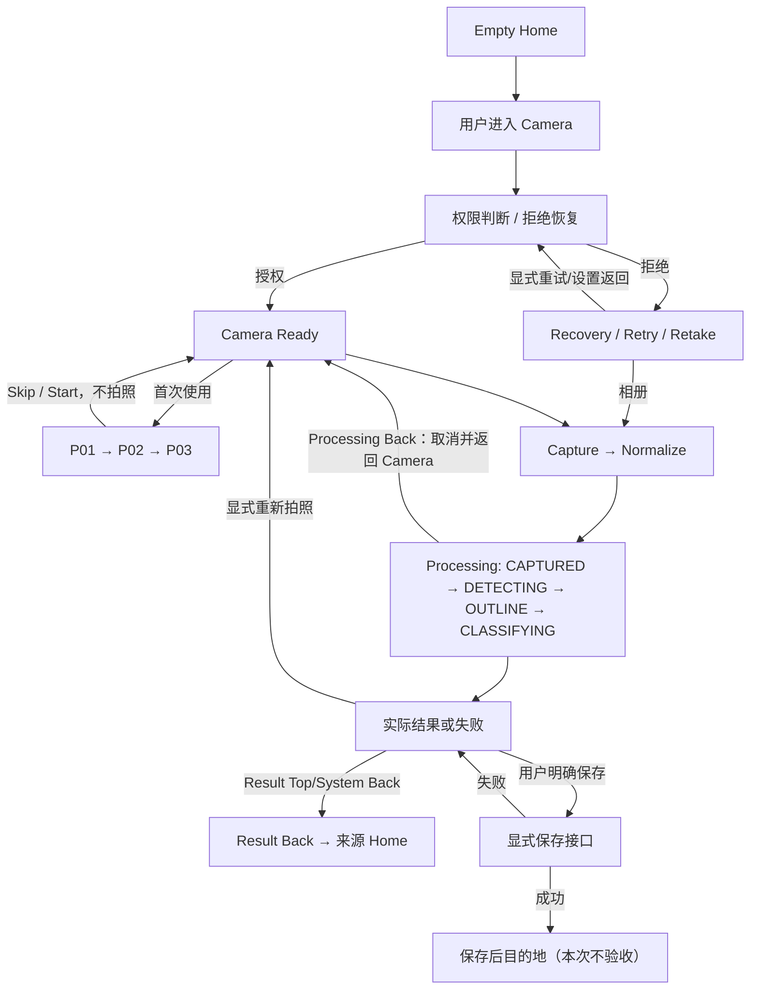

# 渔见 AI 拍照识别主流程 · 主流程合同 V1

**合同 ID：** `RECOGNITION_MAIN_FLOW_SPEC_V1`  
**状态：** `REVIEW_REQUIRED`（规范稿；未进入开发、测试实施或 Runtime 验收）  
**范围：** Empty Home → Camera/Permission → 首次指引 → Capture/Normalize → Detector/Crop/Classifier → Processing → Result/Recovery → 返回来源 Home。

## 权威顺序与边界

本文件是主旅程说明；`02_STATE_MACHINE.yaml` 是页面、业务状态和状态转换的唯一统一状态源。已有冻结合同仍拥有各自的业务/视觉维度，本规范引用而不复制其 Frozen 数值或文案：

- Capture V3.1：`design/system_v3/08_Page_Contracts/recognition/capture/`
- Processing V3.1：`design/system_v3/08_Page_Contracts/recognition/processing/`
- Result V3.1：`design/system_v3/08_Page_Contracts/recognition/result/`
- 首次指引 V1：`design/pages/recognition/first_use_camera_guide/`
- 已批准决策：`docs/qa/recognition_main_journey/SEVEN_DECISIONS_APPROVED_V1.md` 与 `seven_decisions_v1.json`
- 测试用户：`app/src/androidTest/assets/qa/recognition/v1/test_users.json`（本阶段只读）

若规范稿与上述已冻结合同冲突，优先级为：已批准的七项业务决策 → 有效 Frozen 页面合同 → 本规范的未冻结建议。实现不能以当前源码行为覆盖产品合同。结果页面的鱼获保存后详情页、Fish Guide、Normal Home Hero、登录、同步及云端存储均在本次主旅程验收之外；这里只约定保存接口边界。

## 主旅程

| 顺序 | 页面/业务状态 | 进入条件与动作 | 目标/返回 | 持久化及失败边界 |
|---|---|---|---|---|
| 1 | Empty Home / `EMPTY_HOME` | 本地游客状态有效且当前无识别路由 | 点击“开始识鱼”进入 Capture；直接“从相册选择”也进入 Capture | 初始 FishRecord 数为 0；Home 来源记录在本次识别会话；不启动相机前不得请求 CAMERA |
| 2 | Capture / `PERMISSION_REQUIRED` 或 `PERMISSION_DENIED` | Camera 路由被用户主动打开；相机权限未授予 | 有权限请求入口则发起一次系统请求；明确拒绝后留在可恢复状态 | 权限只由 `checkSelfPermission` 的当前系统状态决定；拒绝不能启动 Preview/Capture；Photo Picker 与 Back 独立可用 |
| 3 | Capture / `CAMERA_INITIALIZING` → `CAMERA_READY` | 当前系统权限已授予并完成 CameraX 绑定、Preview Streaming 与 ImageCapture Ready | 首次用户且未完成指引且不是相册入口时进入 P01；复访留在 Camera Ready | CameraX provider 归 Capture host 所有；初始化失败进入 `CAPTURE_ERROR`；退出/后台/撤权/Picker 切换时释放资源 |
| 4 | Guide / `P01` → `P02` → `P03` | Capture Ready 且首次指引资格成立 | Skip 或 P03 Start 关闭 Overlay 并回 `CAMERA_READY`；Back/dismiss 为 `DISMISSED` 并不写完成 | 只有 Skip 与 P03 Start 写 `capture_guide_v1_completed=true`；Start 不自动拍照；覆盖期间不得触发快门或 Picker |
| 5 | Capture / `CAPTURING` → `CAPTURED` | Ready 后一次有效快门；或 Picker 返回可读图片 | 图像归一化成功后仅移交一份 `SelectedImage` 给 Processing | 相机权限仅用于相机流；Gallery 独立；图像方向统一、可解码；失败留在 Capture/Error，不创建 FishRecord |
| 6 | Processing / `CAPTURED` → `DETECTING` → `OUTLINE` → `CLASSIFYING` | 一个有效 Attempt ID、归一化原图与单一任务所有者 | 等待真实 Detector/Crop/Classifier 事件与冻结的最短视觉节拍后分流 | 不以计时器伪造结果/进度/ETA；不改变原图；取消/超时/异常禁止创建记录；最短节拍不是推理超时 |
| 7 | 结果 / `HIGH`、`MEDIUM`、`LOW`、`NO_FISH`、`WARNING`、`INVALID`、`TECHNICAL_FAILURE` | 当前 Attempt 的真实模型/质量门结果到达；受控 UI 测试必须标为非真实模型证据 | 可保存的结果留在 Result；恢复分支提供拍摄/相册；技术异常使用独立技术失败路径 | `WARNING` 本身不等于 INVALID；NO_FISH 优先于 INVALID 的图像质量错误归因；未确认鱼种不得保存；Recovery 不写 FishRecord |
| 8 | Result / `BACK_TO_SOURCE_HOME` 或显式 `RETAKE` | 用户点顶部 Back、系统 Back 或“重新拍摄” | 顶部 Back 与系统 Back 均回识别来源 Home（本测试用户为 Empty Home）；“重新拍摄”返回 Camera | 未保存不新增 FishRecord；清除旧 Attempt、结果和旧图像引用；重拍使用新的 image/attempt identity |
| 9 | 保存接口边界 / `SAVE_IN_PROGRESS` | 用户主动点合法保存动作，必要的鱼种已明确选择 | 成功按既定保存目的地离开识别主线；失败留 Result 并保留草稿 | 保存中顶部 Back 禁用，系统 Back 消费不导航；只有持久化成功后记一条记录。详情页/保存后的流程不进入本次核心验收 |

## Main Journey 状态图

该图聚合主路径；具体 PAGE_ID/STATE_ID、事件 Guard、异常和恢复细节唯一以 02_STATE_MACHINE.yaml 的 38 个状态对象及 transitions 列表为准。

- 保存过程中 Top Back 禁用，System Back 被消费，直到保存结果返回。
- 技术失败、无鱼和图像质量恢复为独立 Result/Recovery 分支；没有通过图示把失败合并成一个结果。
- Empty Home 是固定测试用户的来源 route；其他来源必须由识别会话记录，不从当前 Result route 推断。

## 页面/状态通用字段

完整字段（`PAGE_ID`、`STATE_ID`、`ENTRY_CONDITION`、`EVENT`、`GUARD`、`SIDE_EFFECT`、`NEXT_STATE`、`BACK_TARGET`、`ERROR_PATH`、`RECOVERY_PATH`、`PERSISTENCE`、`OWNER`、`TEST_CASE_IDS`）在 `02_STATE_MACHINE.yaml` 每个状态对象中逐项定义。每条测试用例仍保留唯一主 `initial_state`；子变体不能偷偷替换测试用户状态。

## 结果语义与优先级

1. Detector 未产出可分类鱼体时，根据真实质量门的原因进入 `NO_FISH`；不伪造分类结果。
2. `GOOD` 与 `WARNING` 可分类；`WARNING` 不单独触发图片质量恢复。
3. `INVALID` 且原因是 `NO_FISH` 时优先 `NO_FISH`；其他真实 INVALID 进入既有 Frozen Image Quality Recovery，页面别名为 `IMAGE_QUALITY_WARNING`。
4. Detector/Crop/Classifier/依赖/超时等技术错误进入 `TECHNICAL_FAILURE`，不能归因成无鱼或照片质量差。
5. HIGH/MEDIUM/LOW 均只使用真实模型 payload；Medium/Low 仍必须经用户确认鱼种后才允许保存。

## 识别动效时间合同

Processing 的最短视觉展示：`CAPTURED ≥ 220ms`、`DETECTING ≥ 320ms`、`OUTLINE ≥ 350ms`、`CLASSIFYING ≥ 250ms`。状态变化必须同时满足相应的真实 Pipeline 事件和最短视觉节拍。动效可按 Reduced Motion/性能档降级，但语义状态、顺序和最短冻结要求不变。推理 timeout 是独立参数，当前为 `PARAMETER_REVIEW_REQUIRED`，见 `03_ANDROID_DEVELOPMENT_CONTRACT.md` 与 `14_OPEN_DECISIONS_AND_BLOCKERS.md`。

## 退出、取消与持久化

- Camera 首次权限/引导持久化范围只包含当前 App 的 CAMERA 请求历史提示和 `yujian_capture_guide_v1/capture_guide_v1_completed`；系统权限不由 QA Seed 修改。
- 识别会话持有 source-home route、image ID/file SHA、Attempt ID、pipeline stage、取消状态和当前 Outcome。模型阈值、Frozen 图片和后端数据均不是会话临时状态。
- `NAV-03` Processing Back 必须使旧 Attempt 取消或失效并返回 Capture；迟到回调只能被记录为 stale/ignored。
- `NAV-04/NAV-05` Result Back 均返回来源 Home；当前固定 QA 用户从 Empty Home 发起。未保存不能写入 FishRecord。
- `NAV-07` 只有同一执行所有者仍存活且可安全重绑时才恢复同一 Attempt。后台秒数不是资格条件；Owner 丢失后，图片可读则显式 Retry（新 Attempt ID），图片丢失则 Retake。
- 清理是幂等的：退出/取消/技术失败使当前 Attempt terminal；重拍先使旧 Attempt 失效、释放旧 Bitmap/File lease、清理旧 Result，再建新识别会话。

## 源码审计结论（只读）

- `YujianApp.kt` 把 `recognitionSessionId`、`sessionImage`、`productionResult`、`activeRecognitionAttemptId` 等放在 Compose `remember` 状态；新图像 handoff 会创建 UUID Attempt 并校验迟到结果。
- `RecognizingScreen.kt` 有 `SystemClock.uptimeMillis()` 的展示时钟与视觉状态机；视觉节拍不构成 Pipeline 总超时。
- `FishRecognitionPipeline.kt` 顺序调用 Detector → Quality Gate → Crop → Classifier；发现 NO_FISH/INVALID 时返回结果分流，对 crop/classifier 错误返回失败；本路径未见总推理 timeout 配置。
- `IdentifyScreen.kt` 以 `checkSelfPermission` 初始化权限状态，CameraX Ready 由绑定、Preview Streaming 与 ImageCapture readiness 联合决定；首次未授权时路由 Effect 可请求系统权限，未授权按钮也可以再请求；源码未建立可验证的“不可再次请求”事实或系统设置恢复复核协议。
- Result 的顶部 Back/系统 Back 均通过 `requestExit`，而 App 注入的 `onBack` 当前调用 `startCapture(preserveSession=true)`；这与已批准 NAV-04/05 冲突。保存中 Back 被消费/顶部 Back disabled，编辑草稿放弃确认存在；后续开发仍须用明确的来源 Home 返回策略实现。

上述是源码事实，不是目标合同，也不是 Runtime 验收结果。
